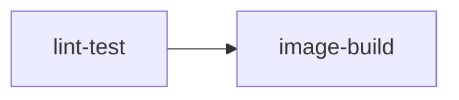

# sample-app CI: what runs and how to fix a red build

This page walks through [`sample-app-ci.yml`](../.github/workflows/sample-app-ci.yml) step by step: what each gate checks, how to reproduce it on your machine, and the usual fix when it fails.

## When the workflow runs

| Event | Condition |
| --- | --- |
| `push` | Only to `main`, and only when `examples/sample-app/**` or the workflow file itself changes |
| `pull_request` | Same path filter, from branches or forks |

Changes that touch only docs, the root README, or Dependabot config do not start a run. If you expect CI and see nothing, check that your diff actually lands inside the path filter.

A newer push to the same ref cancels the run already in progress (`concurrency` keyed on `github.ref`), so a cancelled run usually just means it was superseded.

## Jobs

`image-build` only starts once `lint-test` passes, so a broken test never wastes a Docker build.

### lint-test (10 minute timeout)

| Step | Reproduce locally | Common failure and fix |
| --- | --- | --- |
| Secret scan (gitleaks) | `gitleaks detect --source . --redact` from the repo root | A token, key, or high-entropy string was committed. Rotate the secret first, then remove it from history; deleting it in a new commit is not enough because the scan reads full history (`fetch-depth: 0`). |
| gofmt | `make fmt-check` | Lists the files that need formatting. Run `make fmt` and commit the result. |
| go vet | `make vet` | Usually a printf verb mismatch, an unkeyed struct literal, or a copied lock. Fix the code; do not silence vet. |
| go test | `make test` | `-race -count=1` means a test can fail here even if a cached run passed for you. Run `go test -race -count=1 -run <TestName> -v ./...` in `examples/sample-app` to isolate it. |
| govulncheck | `go install golang.org/x/vuln/cmd/govulncheck@v1.9.0 && govulncheck ./...` | A reachable vulnerability in a module or in the Go standard library. For stdlib findings bump the `go` line in `go.mod` and the `golang:` builder tag in the `Dockerfile` together; for modules run `go get <module>@<fixed version> && go mod tidy`. |

`make ci-local` from the repo root runs gofmt, vet, and tests in the same order as CI. The secret scan and govulncheck need their own tools installed.

### image-build (15 minute timeout)

Builds the multi-stage distroless image with Buildx and `VERSION` set to the commit SHA. Nothing is pushed (`push: false`).

Reproduce with `make image VERSION=$(git rev-parse HEAD)`. Typical failures:

- **Base image tag no longer resolves**: a pinned tag was removed upstream. Merge the pending Dependabot `docker` update or bump the `FROM` line.
- **Go version mismatch in the builder stage**: the `golang:` builder tag in the `Dockerfile` is older than the `go` directive in `go.mod`. Keep the two in step when bumping either one.
- **Timeout**: almost always a cold cache plus a slow mirror. Re-run once before digging further.

## Dependabot pull requests

Dependabot opens updates every Monday for GitHub Actions (prefixed `ci:`), Go modules, and Docker base images (both prefixed `chore:`). They go through the same workflow as any other pull request. If one fails, treat it like a normal red build using the table above; a failing govulncheck on a dependency bump usually means the new version pulls in another vulnerable module.

## Re-running and debugging

- Re-run only the failed jobs from the run page rather than the whole workflow.
- To see shell commands as they run, re-run with debug logging enabled, or add `set -x` to a `run:` block on a branch.
- The workflow has `contents: read` only and checks out with `persist-credentials: false`, so a step that tries to push, tag, or comment will fail by design. See the [threat model](threat-model.md) for why.
